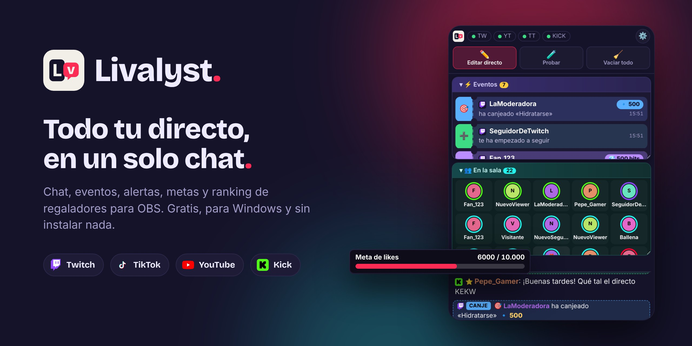

# Livalyst

Chat unificado, alertas y metas para OBS. Junta en un solo sitio el chat y los eventos de **Twitch, TikTok, YouTube y Kick**, y añade widgets para el directo.

## Qué incluye

- **Panel del chat** para OBS (dock): todos los chats juntos, con emotes de FrankerFaceZ, BTTV y 7TV, eventos (regalos, subs, follows…) y quién ha pasado por tu directo.
- **Alertas** de regalos, seguidores, subs y compartidos, con 15 temas y 8 sonidos propios (o los tuyos).
- **Metas** (likes, seguidores, monedas, compartidos) y **ranking de top regaladores**.
- **Avisos de moderación de TikTok** (por ejemplo, la restricción +18) en grande para que no se te pasen.

## Cómo se usa

1. Descarga **Livalyst.zip** de la sección *Releases*, descomprímelo donde quieras y abre **Livalyst.exe**. No hay que instalar nada. La primera vez se abre una bienvenida que te guía para dejarlo listo.
   (Si prefieres usar el código directamente: instala [Node.js](https://nodejs.org) y abre **Iniciar Livalyst.vbs**.)
2. Mientras está abierto, aparece su icono junto al reloj de Windows. Clic derecho en él → **Cerrar Livalyst**. Abrir otra vez **Livalyst.exe** también cierra solo la copia anterior.
3. En OBS:
   - Panel del chat: *Docks → Docks de navegador personalizados* con `http://localhost:8787`
   - Configurar widgets: abre el archivo 'Livalyst Widgets.url'
   - Alertas: fuente de navegador de 800 × 600
   - Metas: fuente de navegador de 600 × 120
   - Ranking: fuente de navegador de 600 × 260

Tus ajustes se guardan aparte (en `%APPDATA%\Livalyst`), así que actualizar la app no los borra.

## Comprobar que todo funciona

Haz doble clic en **Comprobar Livalyst.bat**, en la carpeta del programa. Revisa los archivos, abre Livalyst si está cerrado y comprueba que arranca y que todas sus páginas responden. Al final dice «Todo funciona correctamente» o qué falla.

## Apoya el proyecto

Livalyst es gratis y lo seguirá siendo. Si te ayuda en tus directos y quieres invitarme a un café, puedes hacerlo en Ko-fi:

## Licencia

MIT. Puedes usarlo, cambiarlo y compartirlo libremente.
